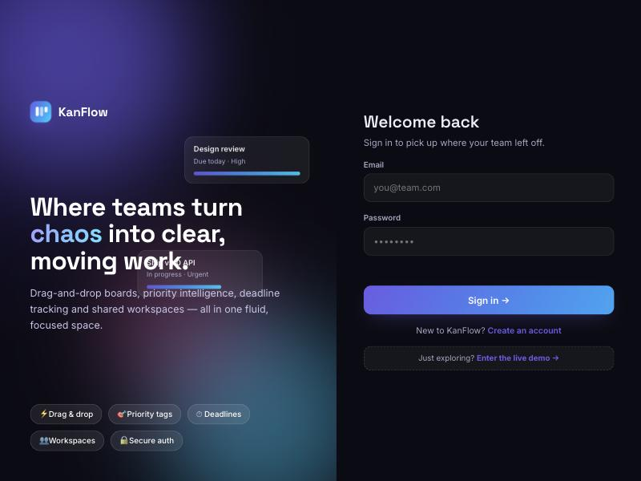

<div align="center">

# 🗂️ KanFlow

### A full-stack Kanban task-management platform — turn chaos into clear, moving work.

Drag-and-drop boards · priority intelligence · deadline tracking · multi-user workspaces · JWT auth

[](https://dakshmehrotraa.github.io/Kanflow/)


</div>

---



## ✨ Overview

**KanFlow** is a Kanban-style productivity platform where teams organize work into
visual boards. Tasks move through columns via drag-and-drop, carry priority tags and
deadlines, and live inside isolated multi-user workspaces secured by stateless JWT
authentication with role-based access control.

> **🔗 Try it now:** **[dakshmehrotraa.github.io/Kanflow](https://dakshmehrotraa.github.io/Kanflow/)**
> Click **“Enter the live demo →”** — no sign-up needed. State persists in your browser.

## 🎯 Features

- **Drag-and-drop boards** — reorder tasks and move them across columns with a live drop indicator.
- **Priority intelligence** — Low / Medium / High / Urgent tags with a consistent color system and one-tap filtering.
- **Deadline tracking** — due-date badges that shift to *amber* when due soon and *red* with an overdue counter when late.
- **Multi-user workspaces** — switch between projects, each with its own columns, tasks, and members.
- **Workspace-level isolation + RBAC** — owner / editor / viewer roles; members only ever see workspaces they belong to.
- **Live stats** — total, urgent-open, overdue, and a completion ring that updates as cards reach *Done*.
- **Polished UX** — editable columns, task editor modal, search, light/dark themes, keyboard shortcuts.

## 🧱 Tech Stack

| Layer     | Technology |
|-----------|------------|
| Frontend (demo) | Vanilla JS SPA (self-contained, zero-build) — the live GitHub Pages demo |
| Frontend (app)  | **React 18 + Vite**, Context API global state, reusable component architecture — consumes the REST API |
| Backend   | Node.js · Express (REST API) |
| Database  | MongoDB · Mongoose ODM |
| Auth      | JSON Web Tokens (stateless) · bcrypt password hashing |
| Access    | Role-based middleware with per-workspace resource isolation |

> **Two frontends, same design system:** `index.html` is the zero-build demo that
> runs on in-browser state (no server needed — it's what GitHub Pages serves).
> **`/client`** is the production **React** app that talks to the live REST API in
> **`/server`**. Pick whichever you want to run.

## 📁 Project Structure

```
Kanflow/
├── index.html              # Zero-build demo SPA (the live GitHub Pages demo)
├── docs/
│   └── screenshot.png
├── client/                 # React 18 + Vite frontend (consumes the API)
│   ├── index.html
│   ├── vite.config.js      #   dev server + /api proxy to the backend
│   └── src/
│       ├── main.jsx · App.jsx · index.css   # entry + design system
│       ├── api/            #   fetch client + typed endpoint helpers (auth/workspaces/cards)
│       ├── context/        #   AuthContext, BoardContext (useReducer), ToastContext
│       ├── hooks/          #   useTheme
│       ├── components/     #   Sidebar, Topbar, StatBar, Board, Column, CardItem, CardModal, AuthScreen
│       └── utils/          #   helpers + native drag-and-drop logic
└── server/                 # REST API
    ├── server.js           # App entry — middleware, routes, error handling
    ├── config/db.js        # MongoDB connection
    ├── models/             # Mongoose schemas
    │   ├── User.js         #   auth + bcrypt + account role
    │   ├── Workspace.js    #   project + embedded columns + members/roles
    │   └── Card.js         #   task: priority, due, tags, column, order
    ├── middleware/
    │   ├── authMiddleware.js    # protect() JWT guard + requireRole()
    │   ├── workspaceAccess.js   # membership isolation + owner/editor/viewer RBAC
    │   └── errorMiddleware.js   # 404 + normalized error responses
    ├── controllers/        # auth / workspace / card logic
    ├── routes/             # /api/auth, /api/workspaces (+ nested cards)
    └── seed.js             # demo data seeder
```

## 🚀 Getting Started

### 1 · Zero-build demo

The root `index.html` is a single self-contained file — just open it:

```bash
npx serve .          # or simply open index.html in a browser
```

### 2 · Backend (REST API)

**Prerequisites:** Node.js 18+ and a MongoDB instance (local or Atlas).

```bash
cd server
npm install
cp .env.example .env          # then edit MONGO_URI and JWT_SECRET
npm run seed                  # optional: load demo data (demo@kanflow.app / demo123)
npm run dev                   # starts on http://localhost:5000
```

Health check: `GET http://localhost:5000/api/health`

### 3 · React client

With the backend running, start the React app in a second terminal:

```bash
cd client
npm install
npm run dev                   # http://localhost:5173
```

Vite proxies `/api/*` to the backend automatically (see `vite.config.js`), so
just register an account in the UI and your boards persist to MongoDB.

## 📡 API Reference

All `/api/workspaces` routes require an `Authorization: Bearer <token>` header.

| Method | Endpoint | Access | Description |
|--------|----------|--------|-------------|
| `POST` | `/api/auth/register` | Public | Create an account, returns a JWT |
| `POST` | `/api/auth/login` | Public | Authenticate, returns a JWT |
| `GET`  | `/api/auth/me` | Private | Current user |
| `GET`  | `/api/workspaces` | Member | List your workspaces |
| `POST` | `/api/workspaces` | Private | Create a workspace (you become owner) |
| `GET`  | `/api/workspaces/:id` | Viewer+ | Get a workspace with its cards |
| `PATCH`| `/api/workspaces/:id` | Editor+ | Update name / color / columns |
| `DELETE`| `/api/workspaces/:id` | Owner | Delete workspace + its cards |
| `POST` | `/api/workspaces/:id/members` | Owner | Add a member with a role |
| `GET`  | `/api/workspaces/:id/cards` | Viewer+ | List cards |
| `POST` | `/api/workspaces/:id/cards` | Editor+ | Create a card |
| `PATCH`| `/api/workspaces/:id/cards/:cardId` | Editor+ | Update a card |
| `PATCH`| `/api/workspaces/:id/cards/:cardId/move` | Editor+ | Move / reorder (drag & drop) |
| `DELETE`| `/api/workspaces/:id/cards/:cardId` | Editor+ | Delete a card |

### Example

```bash
# Register
curl -X POST http://localhost:5000/api/auth/register \
  -H "Content-Type: application/json" \
  -d '{"name":"Ada","email":"ada@team.com","password":"secret123"}'

# Create a workspace with the returned token
curl -X POST http://localhost:5000/api/workspaces \
  -H "Authorization: Bearer <TOKEN>" \
  -H "Content-Type: application/json" \
  -d '{"name":"Product Launch"}'
```

## 🔐 Security Notes

- Passwords are hashed with **bcrypt** and never returned by the API (`select: false`).
- JWTs are **stateless** and verified on every private request — no session store.
- **Resource isolation:** non-members receive `404` (not `403`) so a workspace’s existence is never leaked.
- Role hierarchy enforced per route: `owner > editor > viewer`.

## 🗺️ Roadmap

- [x] React frontend with context-based global state (consuming this API)
- [ ] Real-time board sync via WebSockets
- [ ] Member invites by email + activity feed
- [ ] File attachments on cards

## 📄 License

MIT © Daksh Mehrotra
